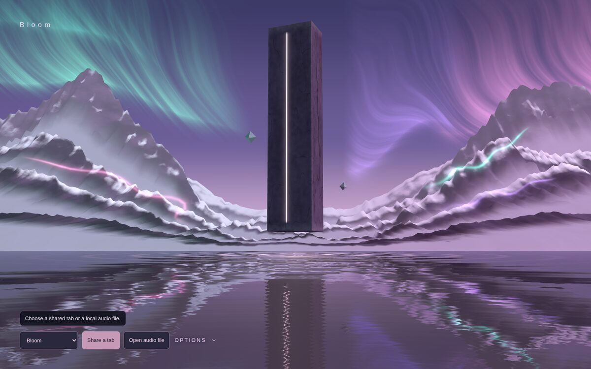
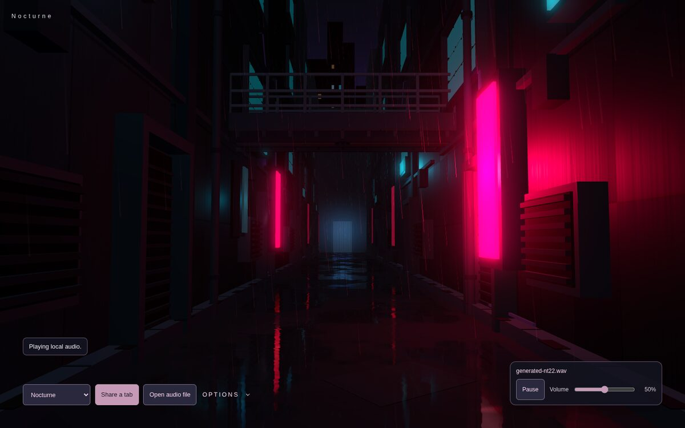
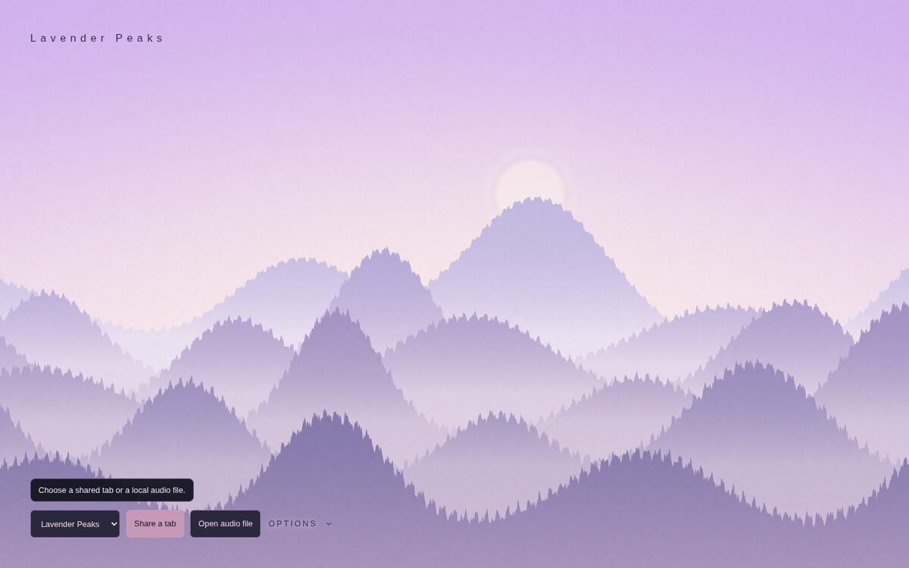
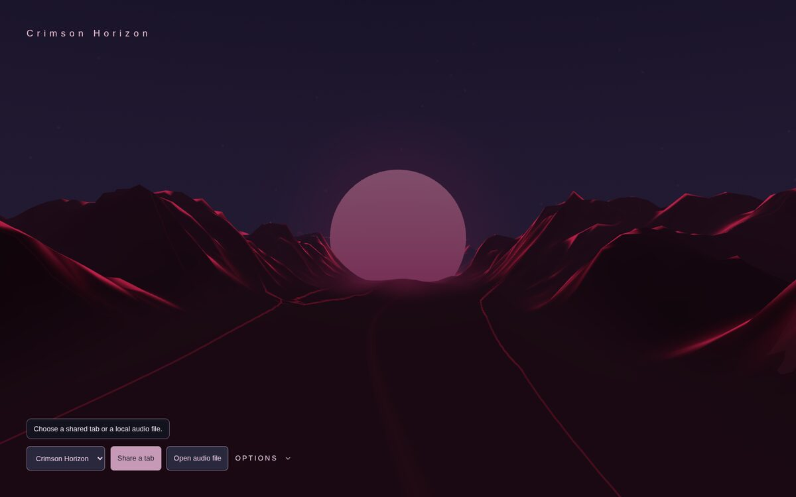

# ECHO

**Your music. Another world.**

ECHO is a music visualizer that runs entirely in your browser. You play a song, and the whole window becomes a hand-crafted landscape that moves with it. Bass swells the sun, melodies light up the mountains, and a drop sends a burst through the scene.

There is nothing to sign up for and no server. Your audio is analysed on your own machine and is never recorded, uploaded or stored.



## Landscapes

Pick a landscape from the toolbar at the bottom of the screen. You can switch while music plays without interrupting it.

| | |
|---|---|
|  |  |
| **Bloom.** A cracked monolith with a glowing seam stands over a mirror-still lake. Snow-capped ranges rise behind it under green and pink aurora, with glowing rivers in the valleys. It follows the structure of a song: the mood darkens in quiet parts, fog builds before a drop, and the drop sets off a swell and a ring burst. | **Nocturne.** A rainy neon alley at night, with magenta, cyan and violet lights that answer to different parts of the music. |
|  |  |
| **Lavender Peaks.** Six misty ridges in soft lavender, one for each frequency band from deep bass at the back to high treble at the front. They slide sideways with the music beneath a warm sun that pulses with the bass. | **Crimson Horizon.** An endless 3D valley that you travel through at a steady pace under a pink sun and a nightshade sky. The sun follows the energy of the music and flares on strong bass hits, and your mouse moves the viewpoint gently. |

## Videos 

https://github.com/user-attachments/assets/03625f8e-48e8-4406-8363-0666c1adacd8


https://github.com/user-attachments/assets/e2fb5331-7b07-42f6-a838-31e85877cdfb


https://github.com/user-attachments/assets/ba12ad9d-8a6c-4321-9f54-3ca76c6ece26


## How it works

1. **Choose a source.** Either *Share a tab* (a browser tab that is playing music) or *Open audio file* (a file from your computer).
2. **ECHO listens.** The audio is split into frequency bands. ECHO also tracks overall energy, onsets (the moments a note or beat starts) and slower context such as how dense or bright the music is. Nothing leaves your browser.
3. **The landscape responds.** Each scene maps those signals to light, motion, fog, colour and camera, so a quiet passage and a drop look clearly different.

ECHO is a companion to your music, not a player or a streaming service. It does not connect to Spotify, YouTube or any other service. It only sees audio you choose to share.

### Controls

- **Landscape selector:** switch between Bloom, Nocturne, Lavender Peaks and Crimson Horizon.
- **Share a tab:** in the browser's picker, choose a tab and turn on *Share tab audio*. Keep playing in that tab. The browser also asks for video; ECHO does not read or show it.
- **Open audio file:** pick a local file. A small player appears on the scene with Play/Pause/Replay and a volume slider.
- **Options:** status, *Disconnect* / *Cancel sharing*, and graphics quality. *Standard* is full resolution; *Low* is softer and renders fewer pixels for slower machines.
- Everything works from the keyboard. Reduced-motion preferences are respected, and silence is handled gracefully (the scenes settle rather than freezing or flashing).

### Browser support

Built and tested on **desktop Chrome on Linux**. Tab-audio sharing needs a Chromium-based desktop browser; other browsers may only support local files. A GPU with WebGL is required.

## Tech stack

| | |
|---|---|
| Language | [TypeScript](https://www.typescriptlang.org/) 7 |
| UI | [React](https://react.dev/) 19 |
| Graphics | [three.js](https://threejs.org/) with [React Three Fiber](https://r3f.docs.pmnd.rs/), plus custom GLSL shaders |
| Audio | Web Audio API for analysis, with local analysis code for bands, onsets and music context |
| Build | [Vite](https://vite.dev/) 8 |
| Lint / tests | [oxlint](https://oxc.rs/docs/guide/usage/linter), Node's built-in test runner |

There is no backend, no database and no analytics. The runtime dependencies are `react`, `react-dom`, `three` and `@react-three/fiber`.

## Getting started

You need **Node.js 24** and npm. It was developed with Node 24.11.0 and npm 11.6.1.

```sh
git clone https://github.com/Jhonneg/echoJs.git
cd echoJs
npm ci
npm run dev -- --host 127.0.0.1
```

Open the address Vite prints (normally <http://127.0.0.1:5173/>), choose a landscape, then use **Open audio file** or **Share a tab**.


### Scripts

| Command | What it does |
|---|---|
| `npm run dev` | Start the development server |
| `npm run build` | Typecheck and build for production into `dist/` |
| `npm run preview` | Serve the production build locally |
| `npm run typecheck` | TypeScript check only |
| `npm run lint` | Lint with oxlint (warnings fail) |
| `npm test` | Run the unit tests |

## Project layout

```
src/
  App.tsx          application shell, toolbar and source controls
  audio/           tab capture, local files, frequency bands, onsets, music context
  engine/          shared canvas, camera tilt, quality and performance
  components/      toolbar, player, status and settings UI
  scenes/
    bloom/  nocturne/  lavender-peaks/  crimson-horizon/
tests/             unit tests for audio maths and scene logic
scripts/           browser verification and evidence scripts
docs/              vision, architecture, art direction, decisions, progress
references/        art references for each landscape
```

Each scene keeps its own shaders, motion and music response, and takes its input from the shared audio features. Scene code does not depend on how the audio was captured.

## Documentation

The `docs/` folder holds the project's working record:

- [VISION.md](docs/VISION.md): what ECHO is and is not
- [ARCHITECTURE.md](docs/ARCHITECTURE.md): audio and rendering contracts
- [ART_DIRECTION.md](docs/ART_DIRECTION.md): the look of each landscape
- [DECISIONS.md](docs/DECISIONS.md): why things are the way they are
- [PROGRESS.md](docs/PROGRESS.md): current status, with evidence under [docs/evidence/](docs/evidence/)

## Status

ECHO is a work in progress and a proof of concept. It has been checked with automated tests and in a headless browser, but not on a range of real hardware, so frame rate on your machine may vary. Try *Low* graphics quality if it runs slowly.
I may add more landscapes in the future, who knows.

