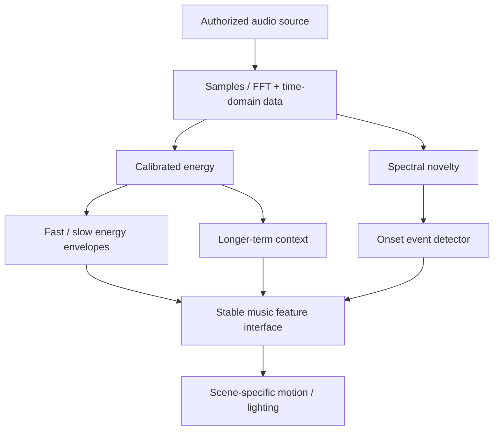
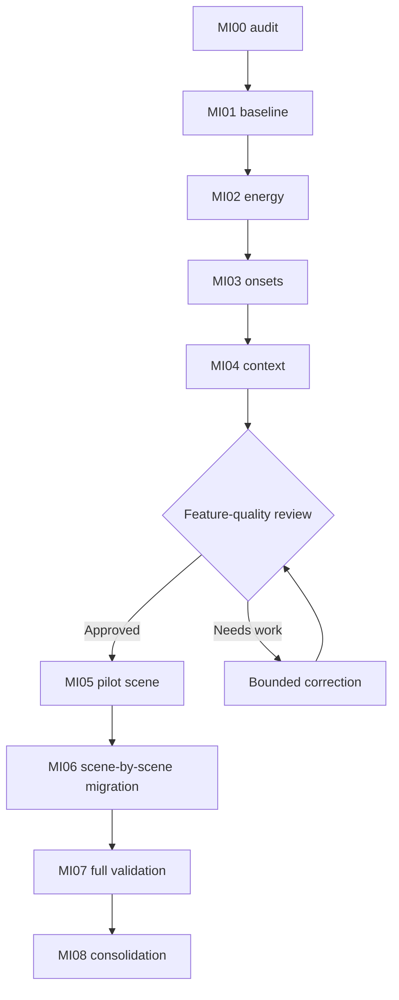

# ECHO — Music Intelligence Roadmap

**Status:** Proposed plan for review · **Scope:** Shared audio engine and its integration into existing scenes · **Owner:** Jhonne · **Version:** 1.0 · **Date:** 2026-11-17

> This is a roadmap, not permission to implement every phase. Approve one bounded task at a time. The existing audio source adapters and landscapes must continue to work while the new features are developed.

## 0. Why we're doing this

ECHO already has browser-tab and local-file audio sources, FFT bands, six-band analysis, fast/slow envelopes, transients, and spectral flux. Yet visual responses can feel inaccurate: quiet and loud bass produce similar-looking effects, a scene sometimes reacts strongly without a perceptually clear bass attack, and scene motion may not match the structure of music. This is an **application-wide issue to investigate**, not a Crimson Horizon-specific bug.

The goal is not to make animations stronger or build an AI-powered instrument separator. It is to expose **trustworthy, expressive musical features** for every landscape:

- **Energy:** How loud/active is this frequency region right now?
- **Events:** Did a meaningful new attack occur, and how strong was it?
- **Context:** How energetic, bright, or busy has the recent passage been?

No band alone identifies an instrument. Low-frequency activity is *not* equivalent to a kick drum. We will use honest names such as `lowOnset` until a classifier is actually implemented and validated.

### Global constraints

1. Maintain browser-tab capture, local-file playback, disconnect/stop behavior, permissions, and privacy. Never persist, upload, record, or transmit captured audio or video. Keep synthetic fixtures and numeric metrics local.
2. Preserve existing scenes, artistic direction, and application architecture. Do not rewrite all scenes or introduce an audio framework at the beginning.
3. No BPM, genre, key, mood, stem separation, instrument identification, ML, native extension, or WebGPU migration in this roadmap's required scope.
4. Work in feature-sized tasks with a plan → owner approval → implementation → evidence → stop cycle. Each milestone includes its own acceptance gate.
5. Maintain an explicit **legacy feature path** until the proposed features prove better with objective tests and listening review. Do not silently break current mapping contracts.
6. Keep frequency analysis and scene animation separate. Audio processing must not depend on a particular world, and per-frame processing must avoid React state writes or unnecessary allocations.

## 1. Proposed feature architecture



These are conceptual modules; do not create files or abstractions until a milestone needs them.

**Measurement layer:** Use actual sample rate and FFT size, handle `-Infinity` bins as silence, and calculate a time-domain RMS or clearly named loudness proxy. Distinguish physical input level from normalized visual control. `AnalyserNode.getFloatFrequencyData()` provides frequency-domain dB values, not a ready-made musical-event stream.

**Feature layer:** Retain interpretable raw magnitudes and produce calibrated, normalized energies; preserve fast and slow energy estimates. Prefer physical-time smoothing over hard-coded per-frame coefficients.

**Event layer:** Derive an onset novelty curve from positive spectral changes; use an adaptive threshold, local peak selection, minimum spacing, and an event strength proportional to measured attack size. An onset is a *new change*, not a signal that remains high for an entire sustained note.

**Context layer:** Add slow energy, spectral brightness and activity estimates only when they improve scene response. Never infer emotion, instrument, or musical genre from those features.

**Scene bridge:** Scenes choose mappings independently. A light's sustained glow should read `energy`; a brief flash should consume an `onset`; atmosphere should read a slower context signal. Event identity/timestamps should prevent one onset retriggering across several display frames.

### Proposed contract (design sketch, not existing API)

```ts
type FrequencyBand =
  | 'subBass' | 'bass' | 'lowMids' | 'highMids'
  | 'presence' | 'air';

interface BandMeasurement {
  rawMagnitude: number;   // nonnegative internal measurement
  energy: number;         // bounded 0..1, calibrated
  fast: number;           // short envelope 0..1
  slow: number;           // sustained envelope 0..1
}

interface AudioOnset {
  sequence: number;       // unique per source session
  timeSeconds: number;    // monotonic timestamp
  band: 'low' | 'mid' | 'high';
  strength: number;       // 0..1, strength of attack
}

interface MusicFeatures {
  timestampSeconds: number;
  sourceActive: boolean;
  rms: number;
  bands: Record<FrequencyBand, BandMeasurement>;
  recentOnsets: readonly AudioOnset[];
  context: {
    intensity: number;
    brightness: number;
    activity: number;
  };
}
```

This interface is deliberately provisional. Final names, arrays and ownership should be set after MI01/MI02 measurements. Existing `AudioSignal` consumers must continue working while the interface is introduced.

## 2. Ordered implementation plan

### MI00 — Reconnaissance and scope lock

**Purpose:** Establish the actual state of the local worktree before changing shared audio code.

**Actions**

- Read `AGENTS.md`, `docs/PROGRESS.md`, roadmap/architecture and current audio files. Review uncommitted scene work and Git status; do not overwrite it.
- Trace both input sources through the analyzer and the live scene reader, including update timing and disconnect/reset behavior.
- Inventory current parameters, normalization formulas, clamps, feature consumers, tests and diagnostic UI. Record what is measured and what is inferred.
- Confirm where the Music Intelligence roadmap belongs in the project's existing documents. Assign an approved next task and any needed checkpoints.

**Exit / approval:** An accurate, short architecture map; known risks; a test plan; no source modifications. **Stop for approval of MI01.**

### MI01 — Observability and baseline (required first implementation)

**Purpose:** Prove what ECHO currently measures before changing how it reacts.

**Deliverables**

1. A **development-only diagnostic lab** with selectable synthetic fixtures, meters/graphs and an exportable, privacy-safe numeric summary. Show input RMS, raw band magnitudes, normalized values, fast/slow envelopes, transient/flux, active-band flags, analysis rate, and feature age. No user-media recording and no raw buffers exported.
2. Deterministic synthetic fixtures: silence, low noise, 100 Hz, 1 kHz, 8 kHz, equal-frequency amplitude sweeps at **-36, -24, -12 and -6 dBFS**, short attacks (20/50/100 ms), a sustained note, repeated hits over a sustained note, mixtures, and a sharp attack with no dominant low frequency. Include known event timestamps.
3. Measurement/reporting for actual source sample rates (where available: 44.1, 48, 96 kHz), FFT behavior, bin indexing, `-Infinity` handling, normalization saturation, band leakage, frame-dependent accumulators and reset on disconnect.
4. Repeat deterministic feature calculations at **30, 60 and 120 update calls per second** using the same input timeline. Distinguish true audio sample/hop cadence from rendering/update cadence.
5. A baseline report with plots or tables: input amplitude → output feature; isolated band response; true attacks / unintended transients; observed delays; saturation percentage; and differences across update cadences.

**Acceptance gate MI01:** All baseline measurements reproducible; raw and processed values visible; silence and reset documented; identified anomalies linked to specific processing stages. **No production normalization or scene mapping changes yet.** Manual source capture remains separately verified.

### MI02 — Accurate energy and dynamic range

**Purpose:** Preserve the difference between quiet and loud sounds without falsely boosting low-level noise.

**Deliverables**

- Time-domain RMS measurement with documented window length; optional log dBFS display. Clarify that RMS/dBFS are useful objective proxies, **not** a complete perceptual loudness model such as LUFS.
- Review FFT power conversion, frequency bins and per-band aggregation. Normalize appropriately across bands with different widths; handle Nyquist and silence safely. Test that one strong bin vs many weak bins behaves intentionally.
- Replace/tune the current saturation curve only after comparing baseline alternatives (e.g. calibrated linear-to-compressed transfer or gentle soft-knee). Preserve raw values for onset processing so the detector can see dynamic contrast.
- Measure floor/noise behavior and design a conservative, calibrated noise gate/hysteresis where necessary. Ensure quiet intentional music is not treated as noise.
- Evaluate **fixed reference** versus **slowly adaptive** range scaling with safeguards: cap gain, don't normalize silence to full scale, don't instantly inflate quiet intros, reset on source changes, and avoid oscillating with each kick.
- Keep independent sensitivities per band only where measured calibration supports them; avoid increasing all gains to make the UI appear lively.

**Acceptance gate MI02:** For identical test tones at increasing amplitudes, raw and visual-energy outputs are monotonic with useful separation over a documented working range. Silence/noise does not create meaningful activity. Band-specific tone tests still isolate correctly. Compare before/after curves and record chosen defaults; preserve compatibility for existing scenes.

### MI03 — Reliable musical onset events

**Purpose:** Distinguish *a new musical attack* from an ongoing note and preserve its strength.

**Deliverables**

- Per-band **positive spectral novelty** from the FFT bins (spectral flux or documented alternative), preserving differences before broad aggregation. Explicitly compare to the current fast-minus-slow transient signal.
- A novelty history and **adaptive threshold**, local-maximum/peak selection, a short minimum-spacing/cooldown, and an event-strength function with useful dynamic range. Hysteresis may help avoid multiple triggers as a hit decays.
- Discrete low/mid/high onset events with sequence IDs and monotonic timestamps. A scene sees each event exactly once; event strength is independent from slow sustained energy.
- Tests with isolated/overlapping attacks, repeated attacks over sustained bass, weak/strong versions of the same hit, silence, white/pink noise (if included), and mid/treble-only attacks. Test 30/60/120 update calls per second and audio source reset.
- Compare observed latency to fixture ground truth; note that FFT window length and peak picking introduce delay. Only consider a shorter-window or AudioWorklet branch if the measured latency/missed-onset rate requires it.

**Acceptance gate MI03:** A sustained tone has at most its initial onset under the agreed test conditions; multiple deliberate attacks produce separate events; event strength increases with identical attacks played louder; silence produces none; wrong-band triggers stay below an agreed baseline. Record precision/recall/false-positive counts and timing against labeled fixtures rather than asserting an arbitrary universal accuracy percentage. Keep limitations of mixed music explicit.

### MI04 — Musical context, without overclaiming

**Purpose:** Give scenes slow, stable signals for artistic atmosphere without mistaking them for discrete beats.

**Deliverables**

- **Intensity:** slow RMS/broadband energy envelope calibrated to preserve quiet/loud passage differences.
- **Brightness:** a stable spectral-centroid-like measure of high-frequency emphasis (normalized to a documented range); do not confuse with perceived volume.
- **Activity/density:** a recent rolling rate/strength of accepted onsets; no BPM claim.
- Clear attack/decay and reset semantics. No per-frame reallocation, unnecessary history growth, or scene-specific dependencies.
- Verify a calm sustained drone, busy percussion, sparse melody, quiet intro → chorus and silence. Assess musical usefulness with the owner, not solely unit tests.

**Acceptance gate MI04:** Slow changes are continuous, distinct from short onset events, bounded, source-independent and reproducible. Scenes can use context without interpreting it as a drum classifier. Pitch/chroma and real beat tracking remain **optional future research**, only if the current scenes justify them.

### G1 — Feature-quality review (stop/go)

Before scene migration, the owner reviews a side-by-side **legacy vs candidate feature mode** on the **same authorized tracks at matched volume**:

- Quiet/loud bass amplitude difference is clearly preserved.
- Sustained bass doesn't repeatedly fire new onsets.
- Mid-only/treble-only examples don't cause strong false bass events.
- Rhythmic sections produce discrete events with believable timing and strength.
- Quiet ambient music remains quiet and artistically usable.
- Local-file and shared-tab features behave similarly when given equivalent source material (allowing for capture latency differences).

If the owner cannot hear/see a reliable improvement, do not proceed to scene changes. Identify the worst failure from diagnostics, tune a single algorithmic variable or revise the gate explicitly.

### MI05 — Stable contract and one pilot scene

**Purpose:** Prove the new features drive an actual landscape more convincingly than old levels do.

**Deliverables**

- Introduce a small, versioned/typed feature reader alongside the legacy `AudioSignal`; avoid breaking existing scenes during migration. Prevent duplicate frame processing and event replays; ensure teardown resets histories.
- Choose **one pilot** after checking current repository status. Nocturne is a good choice *if its static lighting groups are ready*, since continuous energy and discrete onset flashes map naturally to separate fixtures. Otherwise use a simple controlled effect in Bloom/Crimson rather than waiting for new art.
- Provide one developer toggle to compare legacy and new mappings for the same scene/track. Use source-consistent gain, not separate ad hoc boost factors.
- Map **energy → sustained appearance**, **onset strength → discrete responsive accent**, **context → slower atmospheric change**. Apply a scene-local motion/lighting response so onset strength remains visible and the animation doesn't snap.
- Keep existing camera behavior, art direction, performance budgets and reduced-motion behavior.

**Acceptance gate MI05:** On the same track, the pilot scene visibly distinguishes soft/loud events, does not pulse continually on sustained bass, does not overreact during silence, and remains smooth. The owner prefers the candidate in controlled review. No other scene changes in this milestone.

### MI06 — Migrate scenes individually

Each existing landscape gets a **separate approved subtask and review**, not a bulk rewrite:

| Subtask | Candidate mapping | Preserve |
| --- | --- | --- |
| MI06-Bloom | Sustained bass → subtle glow/volume; low onset → halo/ripple accents; mids → fragment motion; highs → shimmer; atmosphere → slow lighting | Gentle ambient motion and visual calm |
| MI06-Lavender | Distinct band energies → independent ridge speeds; attack strength → acceleration accents; scene-local inertia preserves seamless travel | Infinite looping and layer depth; no reversal or seams |
| MI06-Crimson | Energy → continuous sun/terrain brightness; onset strength → proportional sun surge; context → slow environment; avoid counting active bands as substitute for loudness | 3D forward-camera journey and composition |
| MI06-Nocturne | Energy → steady illumination; low/mid/high onsets → magenta/cyan/violet lighting accents; context → haze; emissive + actual light spill + reflection response consistent | Stationary camera, dark alley and contrast |

Avoid assuming “low onset” equals kick, “mid onset” equals snare, or “high onset” equals hi-hat. Those are possible artistic metaphors, not recognition outputs.

**Acceptance gate per scene:** Same-song baseline/candidate comparison, musical specificity, dynamic range, no visual snapping, reduced-motion support, acceptable frame rate and no regressions in other scenes. Update progress and stop after each.

### MI07 — End-to-end validation, performance and privacy

**Purpose:** Ensure the system remains dependable for ordinary users, not just synthetic test tracks.

**Required test matrix**

- Inputs: tab capture and local file; start/stop, permission denial, no-audio tab, switching, silence, seek/pause/end, disconnect/reconnect; no duplicate audio routing.
- Timing: 30/60/120 Hz render/update simulations, actual reference browser/hardware; watch for frame-based spectral accumulation and repeated event consumption. Document real-source timing limits.
- Sample rates: handle actual context sample rates and changes; verify correct band bins. No assumption that request for 96 kHz always succeeds.
- Music: owner-authorized ambient, bass-heavy, vocal/melodic, percussion-heavy, sparse and loud/quiet tracks; do not use synthetic-only pass as proof of real-world quality.
- Performance: allocation/CPU cost of analysis, scene FPS, memory and device cleanup over minutes of playback. If fixed rendering cadence misses short attacks, evaluate fixed-hop processing only after measuring the loss.
- Accessibility: reduced motion, no strobing/aggressive flashing, controlled intensity, clear connection state, quiet transitions.
- Privacy: no recording/storage/transmission of captured audio/video. Synthetic fixtures and aggregate numeric summaries only; screenshots may show ECHO diagnostics, not private source content.
- Comparison: matched track, matched volume, same song section, equal scene settings. Report perceived timing, loudness proportionality, false reactions, fluidity and overall musicality. Reference demos are inspiration, not ground truth.

**Acceptance gate MI07:** Relevant automated checks, target-browser manual checks, no known serious source lifecycle regression, measured performance with documented hardware/settings, and owner review of at least two real genres. Record limitations honestly.

### MI08 — Consolidation and handoff

- Select the validated feature path as default only after MI07 approval. Remove experimental switches/legacy code in a separate reviewed task; preserve fallback only if technically justified.
- Consolidate API types and documentation (`ARCHITECTURE`, `ROADMAP`, `PROGRESS`, `DECISIONS`, audio feature reference, testing/verification). Do not duplicate rules across docs.
- Capture a reproducible calibration guide: tests, how values are normalized, which parameters are safe to tune, expected limitations, and how a new landscape subscribes to energy/onset/context.
- Provide a final technical report: before/after evidence, what improved, remaining false-positive/timing limits, runtime cost, and scoped future research.
- Propose an authorized Git checkpoint/commit. No automatic push or release.

**Acceptance gate MI08:** A fresh Codex session can understand the feature interface and resume from current documentation; new scenes can use the signals without rewriting capture or FFT. Project owner approves the stabilization and next roadmap.

## 3. Evidence and measurement rules

The code and the human listening test must agree. For each implemented milestone include a table with:

| Field | Record |
| --- | --- |
| Commit / task ID | Actual SHA or working state; not invented |
| Input | Synthetic fixture ID or authorized track; volume, sample rate, browser |
| Signal | Raw RMS/band power, calibrated energy, onset strengths/timestamps and context |
| Accuracy | Expected vs detected events, false positives, detection lag, amplitude curve |
| Timing | Analysis update cadence and elapsed timestamps; no assumptions from display FPS |
| Visual | Same track/settings screenshot or reviewer note, separate from numerical results |
| Performance | Hardware, OS/browser, frame rate, feature processing cost, memory if measured |
| Regressions | Audio playback, source switching, disconnect, reduced motion, other landscapes |
| Status | Pass / fail / manual pending / blocked; owner gate approval |

**Starting thresholds are proposed, not pre-validated:** zero events during clean silence, no retrigger of an isolated sustained tone after its initial onset, monotonic output across measured amplitude sweep, no gross wrong-band response to isolated tones, and bounded differences between tested cadences. Quantitative false-positive, timing and loudness-contrast tolerances should be recorded after MI01 baseline and approved before MI02/MI03 implementation, not selected after seeing results.

## 4. Risk register

| Risk | Mitigation |
| --- | --- |
| Display-frame audio polling skips or duplicates novelty peaks | Timestamp analysis, compare cadence tests, consider fixed-hop/AudioWorklet only if justified |
| FFT window smears very short attacks | Measure latency and false negatives first; shorter FFT sacrifices low-frequency resolution |
| Automatic gain amplifies silence or quiet intros | Noise floor, slow bounded adaptation, side-by-side fixed calibration |
| Loudness overcompression persists | Preserve raw magnitudes, inspect saturation distributions and transfer curves |
| Kick/snare names create false promises | Use frequency-qualified onset labels; explicit instrument classification out of scope |
| Double smoothing makes motion lag | Distinguish feature smoothing from scene physical response and time constants |
| Context/feature abstractions become expensive | Keep typed arrays/reusable histories, separate source and scene, measure CPU |
| New algorithm breaks existing scenes | Parallel legacy path + pilot + one-scene-at-a-time migration |
| Endless tuning or token waste | One bounded hypothesis per iteration, synthetic baseline, stop after repeated failure |

## 5. Dependency and approval map



MI02 and MI03 may be prototyped in parallel **within tests**, but production integration must respect the approved gates. MI05–MI08 are proposals for future authorization. The user may pause or revise scope after any gate.

## 6. Copy/paste prompt for Codex

> Read `AGENTS.md` and `docs/PROGRESS.md`, then review `docs/MUSIC_INTELLIGENCE_ROADMAP.md` (or this supplied roadmap) alongside the actual audio implementation. This roadmap is proposed; preserve all existing uncommitted work. First inspect and present an MI00 current-state audit and bounded MI01 plan. Do not implement MI02 or change production normalization, source adapters, scene animation, or lighting yet. Confirm fixture requirements, diagnostics scope, privacy and verification gates. Once I approve MI01 specifically, implement the observability and baseline tests, report measured results, update project docs, and stop for review.

## 7. Source references and caveats

- [MDN: AnalyserNode.getFloatFrequencyData](https://developer.mozilla.org/en-US/docs/Web/API/AnalyserNode/getFloatFrequencyData) — frequency data is in dB and maps to frequencies through half the sample rate.
- [MDN: AnalyserNode.fftSize](https://developer.mozilla.org/en-US/docs/Web/API/AnalyserNode/fftSize) — FFT window size in samples.
- [MDN: getFloatTimeDomainData](https://developer.mozilla.org/en-US/docs/Web/API/AnalyserNode/getFloatTimeDomainData) — time-domain samples suitable for RMS estimation.
- [FMP/AudioLabs: Onset Detection](https://www.audiolabs-erlangen.de/resources/MIR/FMP/C6/C6S1_OnsetDetection.html) — novelty functions and peak picking.
- [FMP/AudioLabs: Spectral Novelty](https://www.audiolabs-erlangen.de/resources/MIR/FMP/C6/C6S1_NoveltySpectral.html) — spectral flux and polyphonic-music limitations.

The architecture references prior discussion of ECHO's public repository. **Codex must inspect the current local branch and uncommitted files before implementing**; formulas and scene modules may have evolved since that discussion. Nothing here claims that these milestone tests have already passed.
