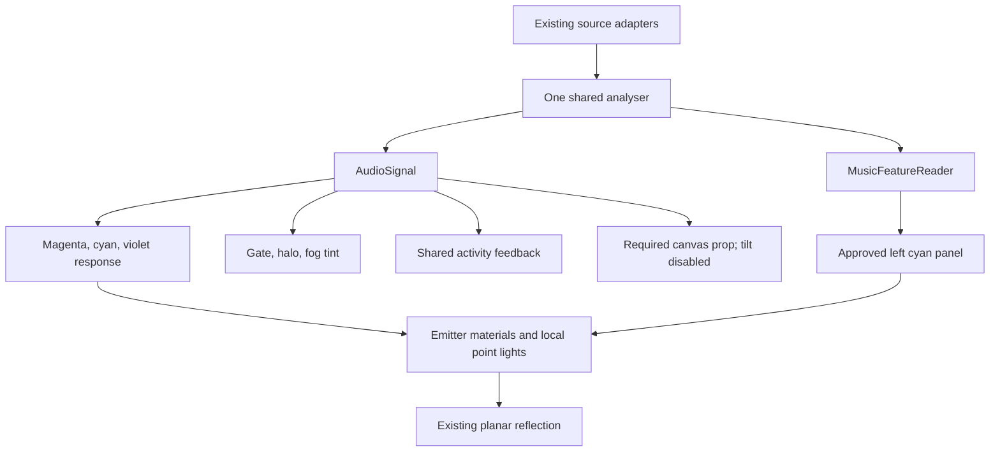

# NT01 — Noctune migration audit

Audited 2026-11-22 at `e627ff821e84dd0f8e781fa9b259805d4822ac39`. Owner approved the presented migration design with “Please implement the plan.” The three new roadmap files were untracked owner additions; preserved and reconciled below. NT01 is approved; NT02 is the next bounded implementation task. Project phase skills are unavailable; follow WORKFLOW.md.

## Current dependency map (before NT02)

| Input / actual source | Consumer and output | Replacement / scene interpretation | Required verification |
| --- | --- | --- | --- |
| `App.tsx` analysis.signal → `NocturneScene.tsx` → `LightingDriver.tsx` | Live legacy entry point | Required existing MI reader; no legacy fallback | Static graph and runtime generated-source trace |
| `reactivity.ts` fast bass, max(transient bass, flux bass) | One shared magenta material, wall fixtures and bridge; points 50/40 | MI low energy sustain, discrete low event accent | Bass isolation, quiet/loud, finite one-shot, no replay |
| Same midrange fields | One cyan material, windows/existing panels; points 65/40 | MI mid energy plus mid events | Mid isolation and contrast |
| Same treble fields | One violet material; two points 12 | MI high energy plus high events | High isolation, reduced-motion timing |
| Legacy atmosphere | Gate emission, halo uniform, fog color | MI context.intensity plus scene easing | Inactive/silence release; no fixture drive from context alone |
| Legacy isPlaying and updatedAt (ms) | Eligibility and stale guard | MI status and updatedAtSeconds; active age 0–.25 seconds | Priming, future/stale/invalid timestamp, connected silence |
| `LandscapeCanvas.tsx` required signal prop | CameraTilt is unmounted for Noctune | Typed disabled-tilt branch permits no signal | Noctune prop removed; Bloom's enabled tilt still requires signal |
| `AudioControls.tsx` analysis.signal.isPlaying | Tab receiving/silent feedback while Noctune selected | MI freshness and nonzero broad energy; adapters retain lifecycle status | Connected silence, signal, stale, source/scene switching |
| `cyanPanel.ts` energy.six.highMids / broad mid events | Independent approved left panel, material ×1.3, point ×30 | Preserve coefficients; repair event/frame bookkeeping only | Existing traces, low-mid-only qualifier, repeated frames, zero/manual suppression |
| `NocturneLightingControls.tsx` manual levels | Four direct fixture overrides; old three-color mix for gate | Same final controls, never publish fake features | All off/on, gain independence, no event replay when leaving Manual |
| `WetGround.tsx`, `Atmosphere.tsx` | Actual reflected scene and stable gate/halo objects | No new audio consumer or render pass | Matched manual captures and resource bounds |

Noctune does not directly read legacy slow, levels, band aliases, intensity, sixBands, updateHz or spectrum. SignalDiagnostics and PerformancePanel are unmounted. Pure clamp/smoothing helpers imported from signal.ts are not legacy data consumers. The shared MI engine itself imports frequency-range and utility types from older modules; removing that infrastructure is outside this migration.

## Verified contract and discrepancies

- Six energy ranges: 20–80, 80–250, 250–800, 800–2500, 2500–6000, 6000–20000 Hz. Broad energy/events: 20–250, 250–4000, 4000–20000 Hz, clipped to Nyquist. Six energies are fixed-reference normalized spectral RMS, not six broad bands or legacy soft-knee values.
- `energy.overall` is the unsmoothed normalized overall target; `context.intensity` is already eased (.75/1.5 seconds). Activity is strength-weighted onset activity over four seconds with .5/1-second easing. Brightness is a smoothed logarithmic spectral centroid with a separate validity flag. Use context before inventing another composite.
- Reader scalar objects and event-list storage are borrowed/reused. Immutable event objects may be retained, but copy scalars needed across frames. Session changes reset the frame counter; events use a global per-session sequence across all three bands, retained for up to 10 seconds / 256 events.
- Active/fresh is not playback state: connected silence remains active. Source adapter state still owns playback lifecycle. Noctune UI must not substitute active status for audible activity.
- Accepted cyan point multiplier is 30, not 40. Preserve distance 9, decay 2, position (-2.35,2.65,-7.3), emitter ×1.3 and geometry. Proposed .6 accent/.28-second tuning remains unapproved.
- Existing material batching prevents independent main/secondary/bridge outputs today. Introduce bounded material splits only in the relevant later artistic phases, not during NT02 routing.
- Current panel history records repeated render reads of one feature frame. Its zero-gain early return and Manual bypass can leave an event eligible for replay. NT02 must advance cursors while suppressed and sample history once per feature frame.
- NT13 recording language must obey AGENTS.md privacy: generated audio/video can be saved; real music can be reviewed live with owner observations, without captured-media recording or inspection.

## Approved migration sequence

NT02 replaces broad-group inputs with calibrated MI low/mid/high energy and discrete event accents, context intensity for atmosphere, removes the Noctune legacy scene/canvas/status path, and adds lifecycle tests. Preserve cyan visual coefficients and all scene geometry. Broad-group baseline curves are scene-local and require measured calibration, not numerical legacy parity. NT03 then consolidates typed state and independent future outputs; NT04 owns full migration visual parity and approval before artistic remapping. Later phases remain sequential and require their stated gates.

NT01 validation: five focused test files passed; 461 local Markdown targets passed before documentation additions. No new browser/performance claim. Production files unchanged during the audit.
